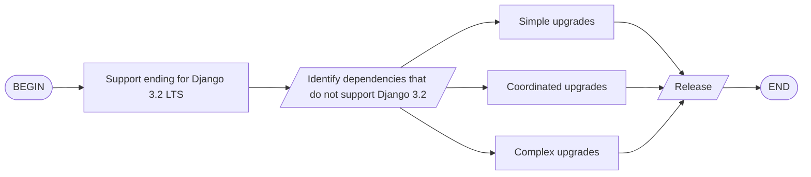
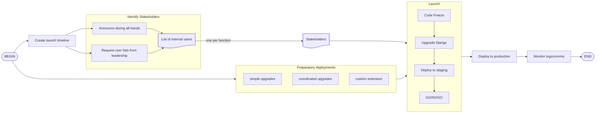

# Django Upgrade: 3.2 -> 4.2

---

# Context

The Django project supports most releases for one year. `x.2` releases are LTS -
they are supported for three years.

Django 3.2 was scheduled to reach EOL one month from when I was tasked with
performing the upgrade.

Django 5.0 had been released, but it was not an LTS, and our dependencies did
not yet support it. Our dependencies had only gained support for 4.2 about six
months prior to this project.

---

# Initial State

- Outdated Dependencies
  - No ongoing upgrade process
  - Many deprecated/abandoned
  - Django 3.2 Compatibility
  - Core libraries multiple major versions behind
- Custom Additions
  - Admin UI
  - GraphQL configuration

---

# Initial Approach

_(how we thought things would go)_

---

# What Actually Happened

- Previously unknown internal users saw unexpected UI changes
- Leadership called for an immediate rollback
- Upon closer examination, only minor changes were needed
- Uncovered a communication gap between engineering and operations

---

# How We Responded

- Immediate rollback
- New launch plan
  - Staged launch
  - Incremental deploys without user-facing changes
  - Stakeholder identification
  - Explicit review period
  - Code freeze for deployment
  - Go/No-Go gate
    - Unanimous approval required

---

# New Launch plan

---

# Tradeoffs

|Decision|Pros|Cons|
|---|---|---|
| Exhaustively identify users | No one is surprised | Timeline drift: ~1 week |
| Staged deployment | Most changes happened _before_ launch window | Bugs could have been introduced |
| Go/No-Go | Approvals for launch exhaustively documented | Launch could be aborted at the last minute |
| Unanimous approval required | No question that every stakeholder group approved | Launch could be aborted due to inability to contact stakeholders | 

---

# How it went

- Stakeholder review in staging wasn't a technical requirement
  - Reinforced collaboration
- Delivery date drift
- Code freeze interruption minimized through notice and communication

---

# Technical Challenges: outdated dependencies

- No process for incremental upgrades
  - Most dependencies hadn't been upgraded since the last Django upgrade
- Many dependencies
  - Most were simple upgrades
    - Deployed in batches of 2-3
  - Some were inter-dependent
    - Deployed as one PR per "parent" dependency
  - Some had custom extensions
    - Isolated to GraphQL, which my team owned
      1. Refactored to support old and new versions
      1. Upgrade library
      1. Remove temporary compatibility layer
  - One core library required replacement (Graphene/graphql)

---

# Organizational Challenges

- The real problem wasn't technical: users didn't know the change was coming
- Engineering did not have well-established lines of communication with
operations
  - My team _wasn't aware_ that Operations used the Django Admin daily
- Key differences:
  - _**clear communication, in advance**_
  - unanimous approval gate

---

# Framing

|Observation|Framing|
|---|---|
|Operations users were unexpectedly impacted|Stakeholders were not properly identified|
|Users encountered bugs|No formal testing plan|
|Operations users encountered broken workflows|Seek stakeholder approval before production deployment|

